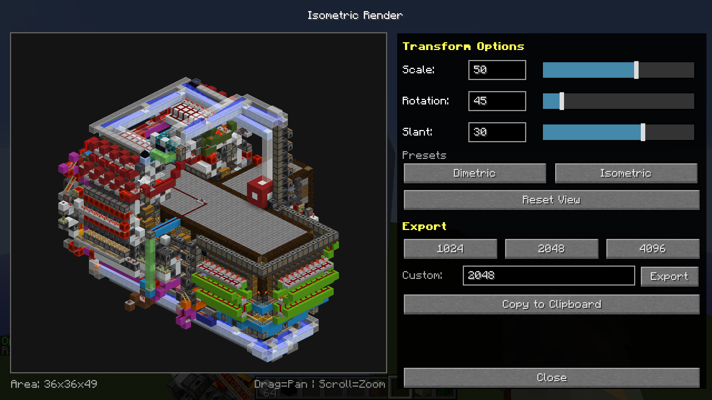

# Isometric Render

Client-side Minecraft 1.12.2 mod that turns any area of your world into a clean isometric PNG.

## Install

Download the file for your loader from [Releases](../../releases) and put it in your `mods` folder:

| Loader | File |
|---|---|
| Forge 1.12.2 | `isometric-render-forge-1.12.2-*.jar` |
| LiteLoader 1.12.2 | `isometric-render-liteloader-1.12.2-*.litemod` |
| Ornithe (Fabric, Gen1) 1.12.2 | `isometric-render-ornithe-1.12.2-*.jar` |

Client only, so it also works on servers that don't have it.

## Use

1. Type `/isorender area x1 y1 z1 x2 y2 z2` with the two opposite corners of the area.
   Tip: look at a block and press **Tab** to fill in its coordinates. Do it once per corner.
2. The render window opens:

   

   - **Drag** the preview to move it, **scroll** to zoom.
   - **Scale**, **Rotation** and **Slant** change the view; **Dimetric** / **Isometric** are quick presets, **Reset View** goes back.
3. Export with **1024**, **2048**, **4096**, or type a size and press **Export** (up to 8192).
   Images are saved with a transparent background to `.minecraft/renders/<resolution>px_<date>.png` (for example `2048px_2026-11-02_14-30-00.png`).
   **Copy to Clipboard** copies the image instead.

## Build

Each loader is its own Gradle project:

```bash
cd forge      && JAVA_HOME=/path/to/java8  ./gradlew build   # build/libs/
cd liteloader && JAVA_HOME=/path/to/java8  ./gradlew build   # build/libs/
cd ornithe    && JAVA_HOME=/path/to/java21 ./gradlew build   # build/libs/
```

## License

MIT
